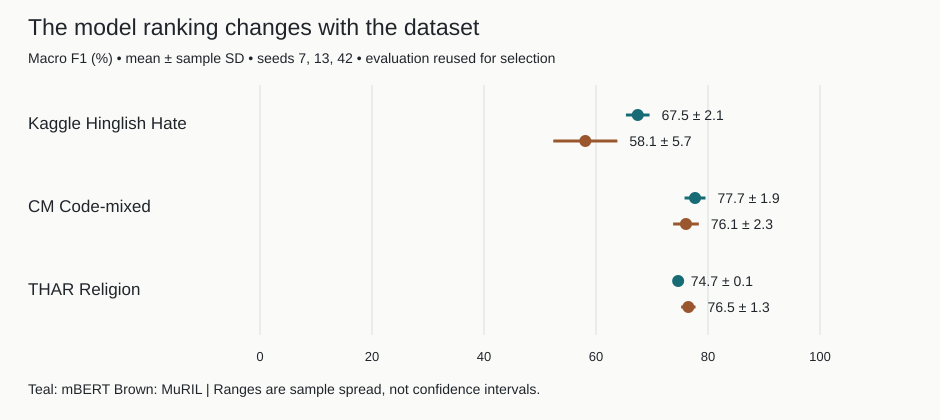

<h1 align="center">mBERT vs MuRIL: Cross-Dataset Hinglish Hate Speech</h1>

[Portfolio case study](https://ompatnaik.com/hinglish/)

**Compare multilingual and Indian-language pretraining across three Hinglish datasets and inspect where model rankings change.**

[Demo or published artifacts](https://huggingface.co/collections/OmTheLast/hinglish-research-mbert-vs-muril-6aa96a16ed03bba0e89e9408)

Python research code. Dataset terms apply separately. Saved public results; full training needs separately prepared data and compute.

By Om Patnaik · repository created July 2026.

[](LICENSE)

## Install

| Platform / path | Start here |
| --- | --- |
| Inspect results | [Read the multi-seed report](docs/matched_multiseed_results.md) |
| Python | `pip install -r requirements.txt` in a virtual environment |

Start with the committed per-seed CSV and report; no model download is needed to inspect them. For training and evaluation setup, follow [the experiment guide](docs/running_experiments.md).

```bash
python scripts/plot_readme_results.py
```

## Why

You need to know whether a model’s apparent advantage survives a change in dataset and label definition. This study compares mBERT and MuRIL on hate, offense, and targeted religious hate. Selection reused the evaluation splits, so the reported values are not untouched final-test results.

## Results



Macro F1 is 67.5% vs 58.1% on Kaggle, 77.7% vs 76.1% on CM, and 74.7% vs 76.5% on THAR (mBERT vs MuRIL). Seeds: 7, 13, 42; split membership also varies for Kaggle and THAR.

Rebuild the chart with `python scripts/plot_readme_results.py` from the committed summary, without model downloads. [Per-seed data](results/multiseed/matched_multiseed_per_seed.csv) · [Aggregate data](results/multiseed/matched_multiseed_summary.csv).

## Choose the right evidence

Matched multi-seed results, transfer, mixtures, and TF-IDF baselines answer different questions. Mixed/transfer evidence is mostly single-seed; two MuRIL mixtures collapsed to all-negative external predictions. The 79-row diagnostic probe is excluded from primary conclusions.

## Load a released checkpoint

The linked collection preserves 26 checkpoints across 14 model repositories. Model cards give labels, loading instructions, seeds, and licensing notes; `main` defaults to seed 42 where available.

## Notes from building it

I tracked label definitions and split policy because changing either changes the comparison. Multi-seed reporting exposed variation hidden by a single run, while error analysis caught collapsed predictions. I would next use independent evaluation and human-reviewed errors before strengthening the conclusions.

## Commands

```bash
python scripts/analyze_results.py                 # analyze saved experiment results
python scripts/plot_readme_results.py             # plot the committed multi-seed summary
python -m compileall -q experiments scripts        # check Python syntax
```

## Verify it yourself

```bash
python -m compileall -q experiments scripts
```

Syntax checks do not reproduce training or establish model quality. Audit the saved means and standard deviations against the per-seed CSV; full reruns require the datasets, model assets, and recorded setup in the experiment guide.

## Credits, license and pointers

Research and analysis by Om Patnaik, with AI coding/documentation assistance. Builds on Google mBERT/MuRIL, Hugging Face, PyTorch, and datasets cited in [the registry](docs/dataset_registry.md). [License](LICENSE); model and dataset terms are separate.

[Full setup, original notes, and project history](README-DETAILS.md).
